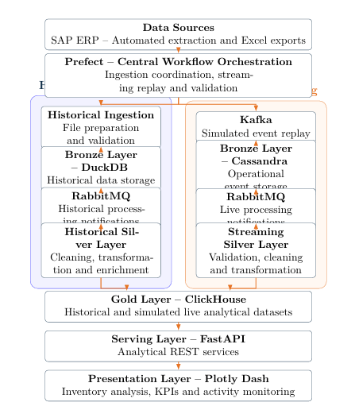

# Supply Chain Inventory Analytics Platform

### An event-driven data engineering platform for industrial inventory monitoring

**TE Connectivity · End-of-Year Internship Project (PFA) · Summer 2026**

`Data Engineering` · `Workflow Orchestration` · `Streaming` · `Analytics` · `Supply Chain`

---

## Overview

Industrial inventory data is often distributed across operational exports and requires substantial preparation before it can support analysis. This project develops an **end-to-end inventory analytics platform** that transforms SAP-derived inventory records into reliable, explorable insights.

The platform combines **historical processing** with a **simulated streaming workflow**, using a Bronze–Silver–Gold architecture to separate ingestion, data preparation, and analytics. A web dashboard provides visibility into blocked stock, inventory ageing, financial exposure, material classifications, and pipeline activity.

> **Data-source clarification:** The streaming workflow replays records from SAP-derived files to simulate incoming events. It is **not** a direct real-time SAP integration.

## Project objectives

- Automate preparation and processing of inventory exports.
- Support both historical analysis and event-driven inventory updates.
- Apply consistent data-quality and transformation rules across processing paths.
- Provide meaningful supply chain KPIs through interactive visualizations.
- Improve pipeline reliability with orchestration, idempotent processing, and monitoring.

## System architecture

The platform implements **two complementary data paths**, coordinated by **Prefect**, which converge at the analytical serving layer.

  
   
  Architecture: historical and simulated streaming pipelines with Bronze–Silver–Gold processing.

### Historical pipeline

1. **Source:** Inventory records exported from SAP into Excel files.
2. **Ingestion:** Data preparation and validation, coordinated through Prefect.
3. **Bronze:** Raw historical data stored in DuckDB; asynchronous processing notifications are exchanged through RabbitMQ.
4. **Silver:** Historical records are cleaned, standardized, validated, and enriched.
5. **Gold:** Prepared analytical data is stored in ClickHouse.

### Simulated streaming pipeline

1. **Event replay:** Kafka publishes inventory records from a reference snapshot as simulated incoming events.
2. **Bronze:** A consumer processes events and maintains operational records in Cassandra.
3. **Messaging:** RabbitMQ notifies downstream processing components.
4. **Silver:** Incoming records are validated and transformed consistently with the historical data model.
5. **Gold:** The streaming analytical view is loaded into ClickHouse.

**Prefect coordinates workflows across the platform**, including historical ingestion, simulated replay initiation, validation, and processing checks. **Kafka and RabbitMQ** handle event transport and asynchronous notifications; Prefect does not replace those messaging systems.

Historical and simulated streaming views are **kept logically separate** because they originate from the same reference snapshot. Their inventory totals must not be added together.

## Key features

| Area | Capabilities |
| --- | --- |
| Inventory overview | Blocked-stock value, record counts, distinct materials, affected plants |
| Stock ageing | Inventory ageing brackets and long-held stock exposure |
| Material analysis | Filtering by plant, material, and batch; record-level exploration |
| Financial insights | Exposure by plant, material category, and highest-value stock lines |
| Data orchestration | Coordinated processing, task monitoring, validation, and workflow status |
| Streaming activity | Events processed, consumer backlog, and sampled processing activity |
| Reliability | Data-quality checks, duplicate prevention, container health monitoring, automated tests |

## Technology stack

| Component | Technologies |
| --- | --- |
| Data processing | Python, SQL |
| Workflow orchestration | Prefect |
| Streaming and messaging | Apache Kafka, RabbitMQ |
| Bronze storage | DuckDB (historical), Apache Cassandra (streaming) |
| Silver transformations | Python data validation, cleaning, and enrichment |
| Gold analytics | ClickHouse |
| API and dashboard | FastAPI, Plotly Dash |
| Deployment | Docker, Docker Compose |
| Source data | SAP-derived Excel inventory exports |

## Results from the reference inventory snapshot

The implementation was validated against an inventory snapshot containing:

| Indicator | Result |
| --- | ---: |
| Blocked-stock records | 1,886 |
| Distinct materials | 547 |
| Plants represented | 6 |
| Total blocked-stock value | €1,158,169.31 |
| Blocked value aged over 90 days | 45.5% |
| Automated tests passed | 44 |

These figures describe the **reference dataset used during the project**, not independently measured operational savings. The historical and replayed views describe the same underlying inventory snapshot.

## Dashboard

The dashboard provides three main areas:

- **Overview:** Supply chain KPIs, ageing distribution, exposure by plant, material categories, and priority stock lines.
- **Materials:** Searchable, filterable blocked-stock records with plant and batch detail.
- **Activity:** Processing-event counts, backlog indicators, and sampled streaming activity.

> **Confidentiality:** Actual SAP exports, internal material or batch identifiers, and operational dashboard screenshots should only be published with authorization. Use anonymized examples for a public repository.

## Implementation notes

This repository represents an **internship prototype** developed for analytical exploration and workflow validation. It uses Dockerized services and separate historical and streaming processing paths. The project demonstrates event-driven processing, data-quality controls, and operational monitoring, but is not presented as a production deployment or as proof of measured inventory optimization.

Running the full solution requires the project's source code, configured services, environment variables, and authorized input data. Setup details should be checked against the accompanying Docker Compose and configuration files rather than copying real internal credentials into the repository.

## What I learned

This project strengthened my experience in **end-to-end data engineering**, **distributed data processing**, **Bronze–Silver–Gold architecture**, **SQL analytics**, **workflow orchestration**, and **data reliability**. It also provided practical exposure to **SAP ERP** and the interpretation of industrial supply chain data.

## Acknowledgements

Developed during my internship at **TE Connectivity**, with guidance from **Chaimae Lazrak** (Supply Chain Manager) and **Tarik Oulidi** (Technical Mentor).

---

  Academic internship project · 2026

